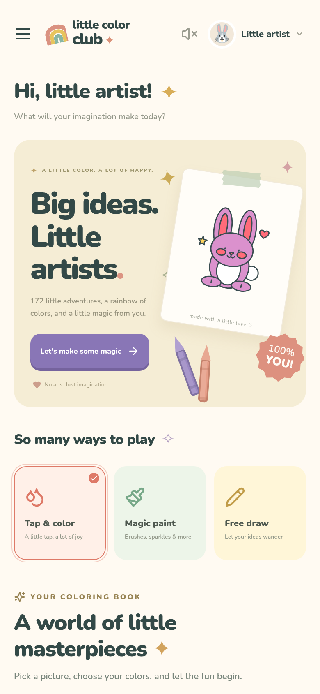
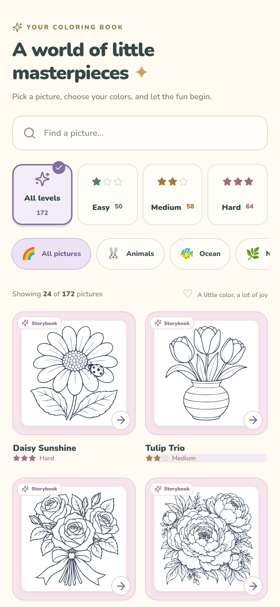
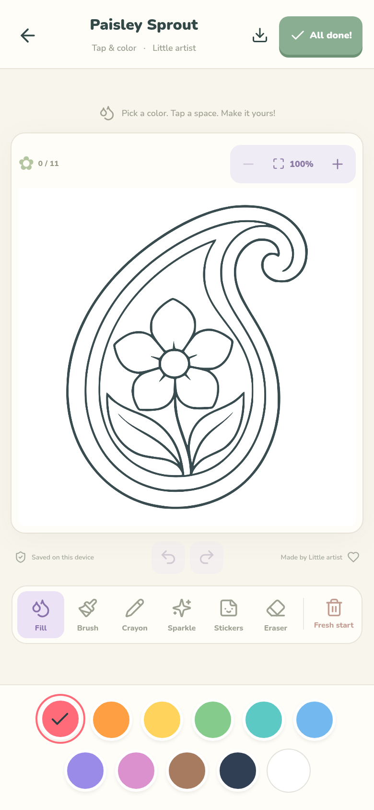

# Little Color Club 🌈

A happy, offline coloring app for little artists, built for Android phones and tablets. Original illustrations, chunky controls, gentle colors, and no accounts, ads, purchases, or analytics.

<p align="center">
  
  
  
</p>

## Try it on Android

**[Download the v1.2.0 test APK](https://github.com/akhileshedd71-rgb/Coloring-App/raw/refs/heads/main/downloads/little-color-club-debug.apk)**

Open that link on your Android device, download the APK, and open it to install. Android may ask you to allow installation from your browser or file manager. This is a debug-signed test build, suitable for trying the app; it is not a Play Store release. Android 6.0+ with an up-to-date Android System WebView is required. Android 7+ is recommended.

The `downloads/` folder contains the v1.2.0 test build and its SHA-256 checksum. Pushes also produce an APK under **Actions → Test and build Android → Artifacts**.

## What's inside

- **172 coloring pages:** 137 original generated illustrations alongside 35 classic vector drawings. Explore 14 categories, including **25 new sharp line-art pages**: 5 each in Flowers, Patterns, Paisley, Doodles, and Cartoons. The existing Animals, Ocean, Nature, Space, Yummy, On the go, Magic, Dinosaurs, and Adventure collections are included.
- **Easy, medium, and hard:** choose a level, browse categories, or search. Pages appear in batches of 24, and the library remembers your filters when you return from coloring. A grown-up can limit the library to one exact difficulty level.
- **Tap & color:** fill enclosed spaces with a spreading color animation and a small burst of sparkles.
- **Magic paint:** smooth brushes, textured crayons, sparkly paint, 12 stickers, and an eraser.
- **Free draw:** a blank canvas for anything children imagine.
- **Glow party:** glowing strokes on a night-blue canvas.
- **Color by number:** only the colors used in the picture appear in the palette. Match numbered spaces, follow gentle tap feedback, and turn hints on or off.
- Eleven colors, three brush sizes, undo/redo, and a reversible fresh start.
- Zoom from **1× to 3×** for smaller details. Use the hand button to move around the picture, the pencil to continue coloring, and Fit to return to the whole page.
- An **All done!** celebration shows the saved picture, with a choice to keep coloring or pick another adventure. Reduced-motion preferences turn off the animated effects.
- Automatic local saving, a gallery, and PNG export. Android uses the native share sheet; browser testing downloads a PNG. Sharing is behind a grown-up check.
- Up to six local profiles with separate galleries, saved-creation counts, picture progress, and difficulty settings.
- Parent gate, optional quiet sound effects (off by default), no vibration, and reduced-motion support.
- Portrait and landscape layouts for phones, tablets, and desktop development.

All fonts, illustrations, and code ship inside the APK. No network connection is needed. The app does not request Internet or storage permissions. Artwork lives in IndexedDB and settings/nicknames in local storage. Android backup is disabled. Uninstalling the app or clearing its data deletes local artwork, so share favorite pictures to keep an external copy. Android sharing sends only the picture you explicitly choose to the app you select.

Illustrated pages use lightweight SVG thumbnails in the library. Detailed paint regions load from bundled local assets when a picture opens, keeping the larger collection quick to browse. The original source artwork, tracing instructions, and review audit are available in [artwork/](artwork/README.md).

This is an original independent app; it is not affiliated with RV AppStudios and does not claim a Teacher Approved badge or Play Store certification.

## Develop

Node.js 22+ and npm are recommended.

```bash
npm ci
npm run dev
```

The development app starts on port 5173. To create a production web build:

```bash
npm run build
```

The companion web build needs a web server; the Android version bundles its assets for offline use.

## Build Android

Install Android Studio, JDK 21, Android SDK Platform 35, and Build Tools 34.0.0/35.0.0. Set `JAVA_HOME` and `ANDROID_HOME` for your machine, or configure the SDK location in Android Studio.

```bash
npm ci
npm run android:build
```

The APK is generated at `android/app/build/outputs/apk/debug/app-debug.apk`.

```bash
npm run android:open   # Open the native project in Android Studio
```

On a Linux x86_64 cloud development machine, an optional local installer is included:

```bash
bash scripts/android-setup.sh
source /workspace/.tools/android-env.sh
npm ci
npm run android:build
```

Set `LCC_TOOLS_DIR` to choose another writable tools location. The installer downloads the official JDK and SDK, checks their published checksums, and accepts the Android SDK development-tool license. It adds the cloud proxy CA to a separate Java trust store when needed; TLS verification remains enabled. Build tools and caches are kept outside the checkout.

A Play Store release will need your own signing key, release build, app listing, and policy review. No release key is stored in this repository.

## Validate

```bash
npx playwright install chromium  # Not needed when system Chromium is available
npm test
npm run build
# With the Android toolchain activated:
cd android && ./gradlew assembleDebug lintDebug
```

Browser tests exercise real canvas pixels, generated fill regions, color matching, brush/eraser behavior, undo/redo, glow, stickers, zoom and panning, reduced motion, completion previews, touchscreen scaling, persistence, paginated filters, profiles, and the parent gate. The CI workflow runs these checks and builds an installable APK. Android runtime behavior still needs testing on a physical device or emulator, especially sharing and system navigation.

## Project guide

- `src/App.tsx` — navigation, profiles, studio controls, gallery, and parent settings.
- `src/components/PaintCanvas.tsx` — touch canvas, region hit testing, ink/outline composition, PNG export.
- `src/components/DrawingLibrary.tsx` — categories, exact difficulty filters, search, and incremental page loading.
- `src/components/StudioViewport.tsx` — zoom, panning, and Fit controls.
- `src/lib/paint.ts` — deterministic brush textures and glow rendering.
- `src/data/drawings.ts` — classic vector drawings, combined catalog, and lazy illustration loading.
- `src/data/illustrated.json` — generated illustration metadata; detailed regions stay outside the JavaScript bundle.
- `public/drawings/` — bundled SVG thumbnails and JSON paint regions.
- `artwork/` — original generated source atlases, manifest, tracing dependencies, and review audit.
- `scripts/trace-illustrations.py` — optional artwork regeneration; Python is not needed to develop, build, or run the app.
- `src/lib/storage.ts` — local persistence.
- `src/lib/export.ts` — native share and browser export.
- `android/` — Capacitor Android shell and Gradle wrapper.
- `tests/` — functional browser checks.

Stack: React 19, TypeScript, Canvas 2D, Vite, Capacitor 7. Nunito fonts are bundled locally under their SIL Open Font License; Lucide icons are used under the ISC license. Dependency license notices are retained in their packages.
